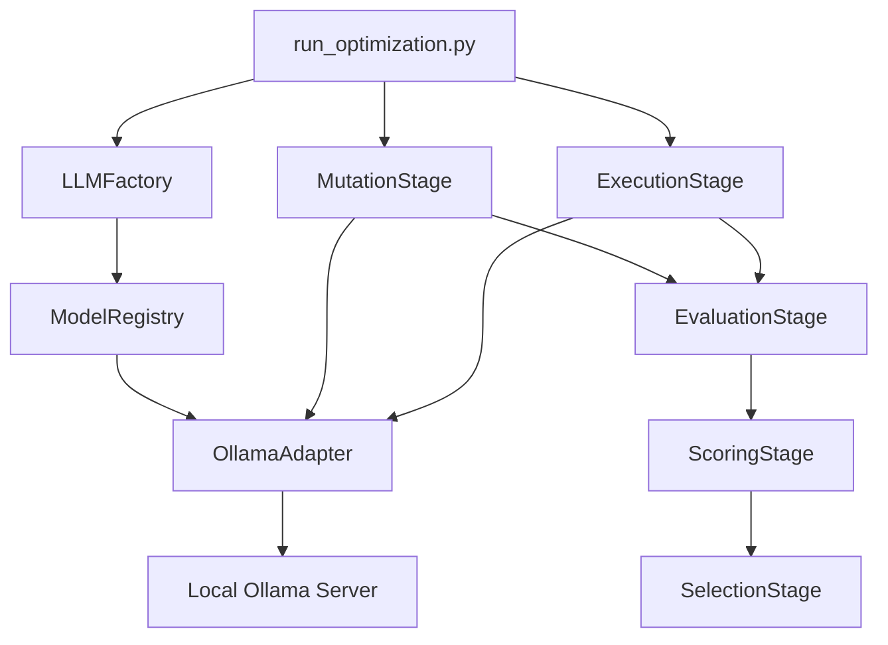

# Implementation Plan: Lightweight Factory-Style Abstraction for Local Ollama Models

## 1. Objective and Design Direction

This revised plan focuses on a practical, reproducible architecture for a student project that must run on modest hardware. The implementation will use a lightweight abstraction layer inspired by the Factory Pattern, but the initial backend will be restricted to small and medium local Ollama models that fit within the 3B–8B range.

The goal is to preserve the current Synthenexa prompt-evolution workflow while making it easier to:

- switch between local models,
- compare prompt optimization behavior across models,
- run experiments reliably on a typical development machine,
- and later extend the design to other providers with minimal code change.

This design aligns well with the project objective:

> Design a prototype that automatically refines user prompts for better results across LLMs.

In this version, “across LLMs” is interpreted as “across multiple lightweight local model families and capacities,” which is both feasible and academically meaningful for a BE-level project.

---

## 2. Recommended Lightweight Ollama Models

The current repository already has access to several Ollama models. For this project, the recommended set should be limited to models that are small enough to run comfortably on consumer hardware without requiring high-end GPUs or large memory budgets.

### Models currently available and suitable for this plan

- nemotron-3-super:cloud
- qwen2.5:3b
- cogito:3b
- qwen:latest
- gemma4:latest (optional, only if hardware is moderately capable)

### Recommended model set for the first implementation

A practical starter set is five models, with Nemotron included as a core baseline model:

| Model | Size range | Role in the system | Why it was selected |
|---|---:|---|---|
| nemotron-3-super:cloud | ~3B–4B class local setup | Core baseline and primary reference model | This is the model you already have locally and it should be treated as a central baseline for comparing prompt refinement across models. |
| qwen2.5:3b | ~3B | Primary general-purpose model | Good balance of speed, quality, and memory efficiency. Suitable as the default model for prompt mutation and lightweight experimentation. |
| cogito:3b | ~3B | Code-oriented fallback | A compact model that is still useful for code-generation tasks and prompt refinement experiments. |
| qwen:latest | ~4B | Balanced secondary model | Good general performance for prompt rewriting and instruction-following without being too heavy. |

### Optional fifth model for later experiments

| Model | Size range | Suggested role | Why include later |
|---|---:|---|---|
| gemma4:latest | ~8B | Higher-capacity comparison model | Useful for measuring whether a slightly larger model improves prompt optimization quality, but should be optional because it may be heavier on memory and slower. |

### Why these choices are appropriate

These models are appropriate because they satisfy the project constraints:

1. Small enough to run on typical laptops or modest desktops.
2. Fast enough for repeated prompt optimization runs.
3. Suitable for instruction-following and code-generation tasks.
4. Reproducible and low-cost because they are local and do not depend on paid cloud APIs.

### Models to exclude from the initial implementation

The following are not recommended as primary choices for this version:

- qwen2.5-coder:32b: too large for the stated hardware limits
- nemotron-3-super:cloud: not appropriate as a primary local experimental backend for this project because it is not a lightweight local model and may not fit the reproducibility goal

### Recommended default configuration for the first phase

The initial implementation should support these four models by default:

- nemotron-3-super:cloud
- qwen2.5:3b
- cogito:3b

This keeps the setup lightweight while still enabling multi-model comparison and explicitly includes Nemotron as a core model in the combined Ollama setup.

---

## 3. Updated Architecture Based on the Lightweight Factory Pattern

The architecture will remain simple and modular while staying practical for a student project.

### High-level idea

The prompt-evolution pipeline will not directly depend on a specific Ollama model implementation. Instead:

- the pipeline asks for an LLM service,
- the abstraction layer selects the correct adapter,
- the adapter sends the request to the chosen local Ollama model,
- and the rest of the pipeline continues unchanged.

### Architectural components

1. Prompt Evolution Pipeline
   - existing mutation, execution, evaluation, scoring, and selection stages

2. LLM Abstraction Layer
   - a small interface and factory that hide provider-specific details

3. Ollama Adapter
   - handles request formatting, retries, output cleaning, and model dispatch

4. Model Registry
   - stores metadata about supported lightweight models and their roles

5. Configuration Layer
   - environment variables and defaults for local development and Dev Container usage

### Flow of execution

1. The user launches the optimization script with a selected lightweight model.
2. The factory resolves the appropriate Ollama adapter for that model.
3. The mutation stage uses the adapter to generate prompt variants.
4. The execution stage uses the same adapter to generate Python code solutions.
5. Evaluation and scoring remain unchanged.

### Mermaid diagram

### Design principle

The core pipeline should remain the same. Only the model access layer changes, which keeps the system easy to understand and maintain.

---

## 4. Revised Implementation Roadmap

### Phase 0 — Baseline and Constraint Definition

**Goal:** Lock in the hardware-friendly scope before implementation starts.

**Tasks:**
- confirm current pipeline behavior with the existing lightweight Ollama setup,
- define the supported model list,
- decide which model roles will be used for mutation and execution,
- establish evaluation metrics for prompt optimization.

**Expected outcome:**
A clear and feasible baseline aligned with modest hardware limits.

### Phase 1 — Introduce the Abstraction Layer

**Goal:** Replace the current direct Ollama coupling with a simple adapter/factory interface.

**Tasks:**
- create the interface and adapter modules,
- implement an Ollama adapter for local inference,
- implement a factory that resolves the correct adapter for the selected model,
- keep the existing `LLMService` entry point as a compatibility layer.

**Expected outcome:**
The pipeline can request an LLM backend through a common interface without modifying the stage logic.

### Phase 2 — Add Model Registry and Configuration

**Goal:** Make lightweight model selection explicit and configurable.

**Tasks:**
- define model metadata such as name, role, temperature defaults, and expected resource profile,
- add environment variables for default model selection,
- allow the CLI to choose a single lightweight model for a run.

**Expected outcome:**
Users can switch models easily without editing the source code.

### Phase 3 — Support Multi-Model Experimentation

**Goal:** Compare how the same prompt optimization process performs across multiple lightweight models.

**Tasks:**
- support running the pipeline on a list of models,
- collect per-model evaluation metrics,
- compare prompt-performance trends across models.

**Expected outcome:**
The system can empirically evaluate prompt refinement across multiple lightweight models.

### Phase 4 — Documentation and Reproducibility

**Goal:** Make the project suitable for report writing and future reuse.

**Tasks:**
- update run instructions,
- document recommended hardware expectations,
- document the supported model set and model roles,
- write tests for the new abstraction layer.

**Expected outcome:**
A reproducible prototype that is realistic for a student project and easy to explain academically.

---

## 5. Repository Impact Analysis

The repository already has a clear separation between the pipeline workflow and the LLM service layer, so the abstraction can be introduced without major structural disruption.

### Files to be modified

| File | Why it needs to change | What will change | Dependencies |
|---|---|---|---|
| synthenexa_pipeline/services/llm_service.py | This is the current LLM access entrypoint. | It should become a thin compatibility wrapper over the new abstraction layer instead of directly handling Ollama requests. | New adapter and factory modules |
| synthenexa_pipeline/scripts/run_optimization.py | The CLI currently creates and uses a single LLM service directly. | It should instantiate the new abstraction layer while keeping the current CLI behavior intact. | config module and wrapper service |
| synthenexa_pipeline/core/config.py | The current config only defines one model name. | It should be expanded to include lightweight model defaults and environment-based selection. | env variables and registry |
| synthenexa_pipeline/pipeline/prompt_evolution/stages/mutation.py | The mutation stage calls the LLM service. | It should continue to use the same interface, so only indirect changes should be needed. | wrapper service |
| synthenexa_pipeline/pipeline/prompt_evolution/stages/execution.py | The execution stage also depends on the LLM service. | It should continue using the same interface without requiring stage-level rewrite. | wrapper service |
| synthenexa_pipeline/RUN_PIPELINE.md | Existing docs assume a single model workflow. | The documentation should describe lightweight model selection and local Ollama usage. | new config and CLI options |
| .devcontainer/devcontainer.json | The Dev Container currently exposes the Ollama base URL. | It may need additional environment variables for lightweight model defaults. | `.env` and runtime config |
| .env | Local config currently points to a single Ollama endpoint. | It should be extended with model-related variables for the new architecture. | runtime config |
| .env.example | The example environment file should reflect the new lightweight model setup. | It should document the new variables. | `.env` |

### Files to be created

| File | Why it needs to be created | Functionality added |
|---|---|---|
| synthenexa_pipeline/services/llm/__init__.py | To organize the new abstraction layer as a package. | Makes the new modules discoverable. |
| synthenexa_pipeline/services/llm/base.py | Defines the shared LLM interface. | Establishes the contract used by the pipeline. |
| synthenexa_pipeline/services/llm/ollama_adapter.py | Implements the Ollama-specific adapter. | Handles requests, retry handling, and output cleaning. |
| synthenexa_pipeline/services/llm/factory.py | Resolves the correct adapter for a given model. | Implements the lightweight factory behavior. |
| synthenexa_pipeline/services/llm/registry.py | Stores supported lightweight models and their metadata. | Centralizes model selection and defaults. |
| tests/services/test_llm_factory.py | Covers the abstraction layer. | Verifies that the right adapter is selected. |
| tests/services/test_ollama_adapter.py | Covers adapter behavior. | Verifies request formatting and output handling. |
| tests/pipeline/test_pipeline_model_switching.py | Ensures the workflow stays compatible. | Checks that the pipeline still runs with different models. |

### Files to be removed

- No files need to be removed in the initial implementation.
- The current `llm_service.py` file should remain as a compatibility wrapper rather than being deleted.

---

## 6. Configuration Changes for Local Development and Dev Containers

### Environment variables

The following environment variables should be introduced or documented:

| Variable | Default value | Purpose |
|---|---|---|
| OLLAMA_BASE_URL | http://host.docker.internal:11434 | Ollama endpoint for Dev Container usage |
| OLLAMA_API_BASE | http://host.docker.internal:11434 | Compatibility alias |
| OLLAMA_DEFAULT_MODEL | nemotron-3-super:cloud | Default model for the pipeline |
| OLLAMA_MUTATION_MODEL | nemotron-3-super:cloud | Preferred model for prompt mutation |
| OLLAMA_EXECUTION_MODEL | cogito:3b | Preferred model for code generation |
| OLLAMA_MODEL_LIST | nemotron-3-super:cloud,qwen2.5:3b,cogito:3b,qwen:latest,gemma4:latest | Comma-separated list of supported lightweight models |
| OLLAMA_TIMEOUT_SECONDS | 600 | Request timeout |
| OLLAMA_MAX_RETRIES | 3 | Retry count for failed calls |

### Local development configuration

For local host usage, the default base URL should be:

- http://localhost:11434

For Dev Container usage, the default should be:

- http://host.docker.internal:11434

### Recommended runtime behavior

The system should support:

- a single-model run as the default mode,
- a future multi-model comparison mode that uses the same abstraction layer.

The first implementation should remain single-model per run for simplicity and reproducibility.

---

## 7. Class and Module Design

### Proposed modules and responsibilities

#### 1. `services/llm/base.py`

**Classes / interfaces**
- `BaseLLMAdapter`

**Responsibility**
- define the common contract used by the pipeline, such as `generate(prompt, system, temperature)`.

#### 2. `services/llm/ollama_adapter.py`

**Classes**
- `OllamaAdapter`

**Responsibility**
- send requests to the local Ollama API,
- convert prompts into the proper payload,
- handle retries, timeouts, and output cleaning.

#### 3. `services/llm/registry.py`

**Classes**
- `ModelSpec`
- `ModelRegistry`

**Responsibility**
- store the lightweight model list,
- define each model’s role and default behavior,
- provide a central place for model selection.

#### 4. `services/llm/factory.py`

**Classes**
- `LLMFactory`

**Responsibility**
- create the appropriate adapter instance for the selected model,
- preserve a simple and clear interface for the rest of the system.

#### 5. `services/llm_service.py`

**Classes**
- `LLMService` (compatibility wrapper)

**Responsibility**
- preserve the old interface used by the current pipeline,
- delegate to the new abstraction layer without forcing stage rewrites.

### Interaction model

The interaction should be simple:

- `MutationStage` calls the service for prompt variants.
- `ExecutionStage` calls the same service for code generation.
- The wrapper service delegates to the factory.
- The factory resolves the adapter based on the configured model.
- The adapter sends the request to Ollama.

This keeps the workflow logic unchanged while isolating model-specific implementation details.

---

## 8. Migration Strategy

The migration should be incremental so the current pipeline keeps working while the new abstraction is introduced.

### Step 1 — Add the new modules without changing behavior

- create the new `services/llm` package,
- implement the basic Ollama adapter,
- keep the old behavior intact at first.

### Step 2 — Route `LLMService` through the new abstraction

- change `LLMService` to delegate to the factory,
- preserve the same constructor signature (`model`, `base_url`, `temperature`),
- maintain the same output formatting and retry behavior.

### Step 3 — Keep the workflow stages unchanged

- mutation and execution stages should continue calling `generate(...)` exactly as before,
- no stage-level logic rewrite should be necessary.

### Step 4 — Add lightweight model configuration

- add the new environment variables,
- make model selection configurable through the CLI or environment.

### Step 5 — Introduce multi-model evaluation later

- once single-model runs are stable, support running experiments across multiple lightweight models.

### Compatibility concerns

- existing code that instantiates `LLMService` should continue to work,
- the CLI flag `--model` should remain supported,
- the abstraction should not force the stages to know which backend is being used.

---

## 9. Testing Strategy

The implementation should be tested at multiple levels.

### Unit tests

Focus on isolated logic:

- factory selects the correct adapter for a given model name,
- adapter formats the payload correctly,
- output cleaning removes markdown fences correctly,
- retries are triggered when requests fail,
- registry returns the correct metadata for each supported model.

### Integration tests

Use a local Ollama instance to verify:

- prompt mutation requests succeed,
- code-generation requests succeed,
- error handling is reasonable,
- retry behavior works under transient conditions.

### End-to-end pipeline tests

Run the prompt optimization workflow on a small subset of tasks to verify that:

- mutation still generates candidates,
- execution still produces code outputs,
- evaluation and scoring still work,
- the overall pipeline completes successfully.

### Recommended initial test scope

- one unit test suite for the factory and registry,
- one integration test suite for the adapter,
- one end-to-end smoke test with a small generation count.

---

## 10. Future Extensibility

The architecture is intentionally simple today but ready to grow.

### How cloud providers can be added later

To support providers like OpenAI, Gemini, Groq, or Claude later:

- create a new adapter implementing the same interface,
- register it in the factory,
- add the provider-specific model prefix and config handling.

The rest of the pipeline remains unchanged because the workflow depends only on the common interface.

### Why this design remains useful long term

- the prompt optimization workflow stays stable,
- provider-specific logic stays isolated,
- the project remains low-cost and reproducible now,
- and the codebase can evolve toward multi-provider support later without a redesign.

---

## 11. Final Execution Checklist

Use the following checklist during implementation.

### Milestone 1 — Baseline and configuration
- [ ] Confirm the current pipeline runs with the existing local Ollama setup.
- [ ] Finalize the initial lightweight model set.
- [ ] Define the default model roles for mutation and execution.

### Milestone 2 — Abstraction layer
- [ ] Create the new `services/llm` package.
- [ ] Define the adapter interface.
- [ ] Implement the Ollama adapter.
- [ ] Implement the factory.
- [ ] Implement the model registry.

### Milestone 3 — Compatibility and migration
- [ ] Refactor `LLMService` into a compatibility wrapper.
- [ ] Ensure the existing pipeline stages still work without modification.
- [ ] Ensure the CLI still accepts the same model argument.

### Milestone 4 — Configuration and environment support
- [ ] Add the recommended environment variables.
- [ ] Ensure local development uses the correct Ollama endpoint.
- [ ] Ensure Dev Container use works with the same settings.

### Milestone 5 — Testing and validation
- [ ] Add unit tests for the factory and registry.
- [ ] Add integration tests for the Ollama adapter.
- [ ] Run a full pipeline smoke test with a small configuration.

### Milestone 6 — Documentation and readiness
- [ ] Update the run instructions.
- [ ] Document the supported lightweight models and their intended roles.
- [ ] Prepare the project for the next round of experiments and report writing.

---

## Summary Recommendation

This revised plan is the most suitable choice for the project because it is:

- practical for modest hardware,
- affordable and reproducible,
- easy to explain in a research report,
- and structured enough to support future expansion.

The most appropriate first implementation is a lightweight adapter-based architecture centered on local Ollama models, with the prompt-evolution pipeline remaining the main scientific contribution.
